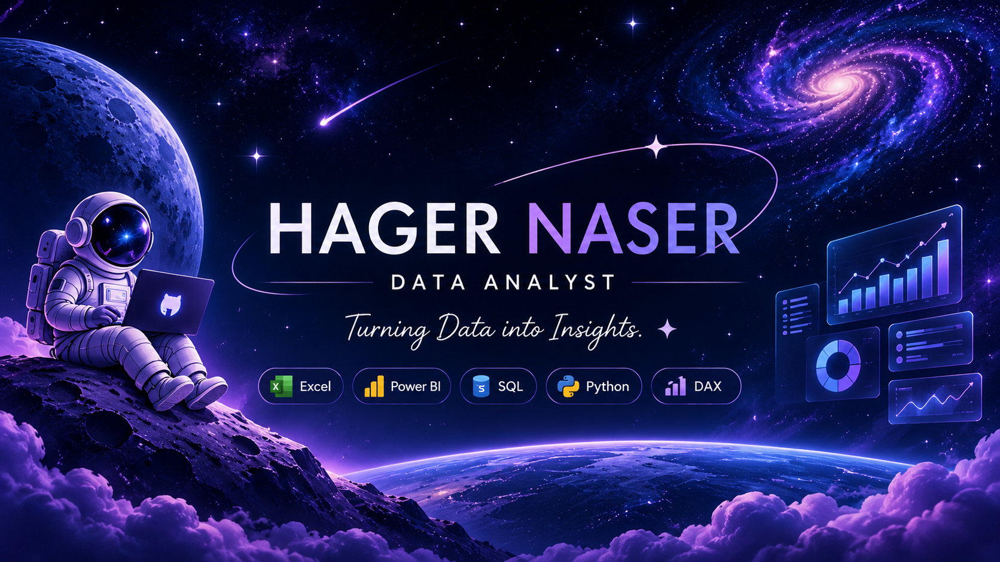

 

### ✦ Welcome to my little universe ✦

**Junior Data Analyst | Business & Data Enthusiast**

*Turning data into insights, finding stories behind numbers.*

 

---

<h2 align="center">✦ MY TOOLKIT ✦</h2>

---

<h2 align="center">✦ EXPLORING DATA UNIVERSE ✦</h2>

<table>
<tr>
<td width="50%" align="center">

### 🌌 Sales Performance

Power BI Dashboard

Exploring revenue, sales and profitability trends.

**Power BI · DAX**

Repository coming soon

</td>

<td width="50%" align="center">

### 🪐 COVID-19 Analysis

Data Analysis Project

Exploring global patterns across countries and regions.

**Excel · Power BI**

Repository coming soon

</td>
</tr>
</table>

---

<h2 align="center">✦ CURRENTLY EXPLORING ✦</h2>

`SQL` &nbsp; `Python` &nbsp; `Data Analysis`

---

### ✧ A little curiosity goes a long way ✧

**One insight at a time.**

<a href="https://www.linkedin.com/in/hager-naser/">
Connect with me on LinkedIn
</a>

